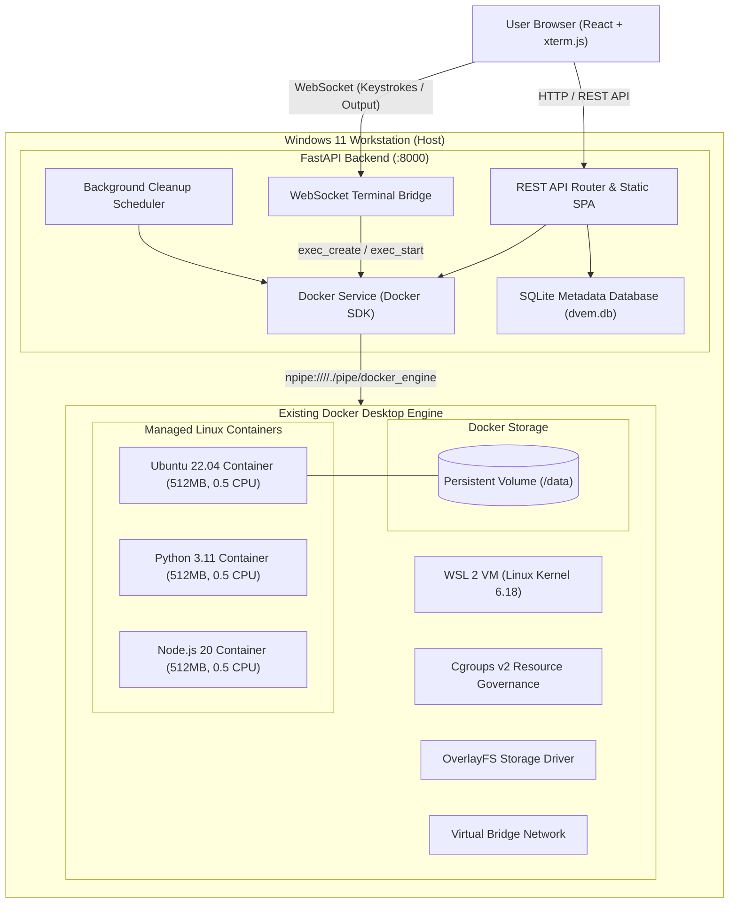
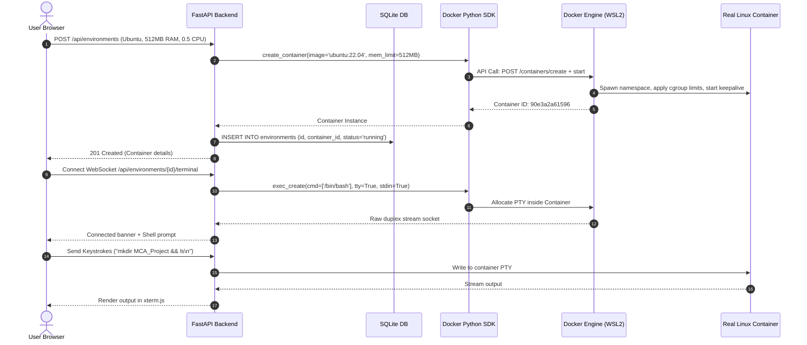
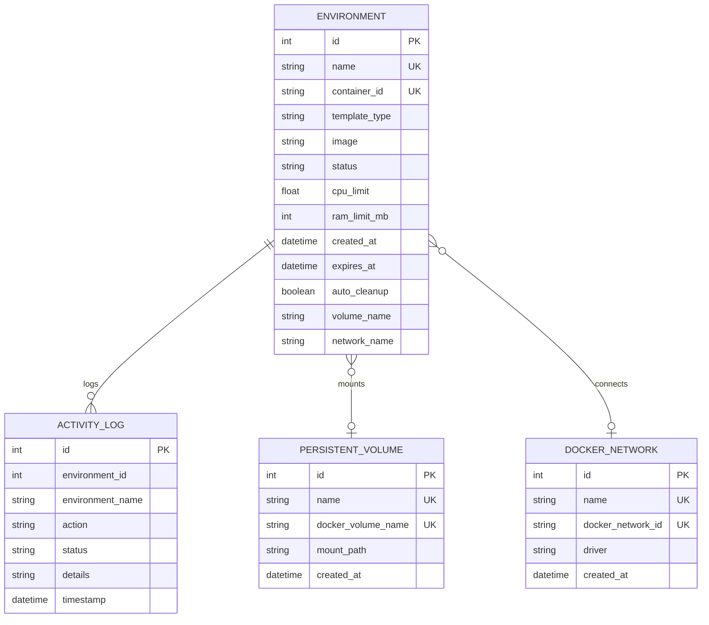

# DISPOSABLE VIRTUAL ENVIRONMENT MANAGER (DVEM)
### Master of Computer Applications (MCA) Project: Cloud Computing & Virtualization

[](https://www.docker.com/)
[](https://fastapi.tiangolo.com/)
[](https://react.dev/)
[](https://www.typescriptlang.org/)
[](https://tailwindcss.com/)

---

## 1. Executive Summary & Project Introduction

The **Disposable Virtual Environment Manager (DVEM)** is an advanced, production-grade cloud virtualization platform developed for academic evaluation in Master of Computer Applications (MCA). DVEM provides on-demand, disposable, isolated Linux development and testing environments directly within a web browser without requiring users to install secondary operating systems, hypervisors, or language runtimes on their host workstations.

Unlike simulated or mocked educational dashboards, DVEM is built directly on top of the host's existing **Docker Desktop Engine (WSL 2 backend with Cgroups v2)**. Every environment launched in DVEM is an **actual Linux container** running with kernel-enforced process namespaces, strict CPU and RAM cgroup limits, dedicated virtual network bridges, and optional persistent volume storage. Users can open an interactive **xterm.js browser terminal** over WebSockets to execute genuine Linux commands, compile code, manage dependencies, and upload/download files in complete isolation.

---

## 2. Problem Statement

Modern software development and academic lab exercises frequently require executing untrusted scripts, experimenting with diverse language runtimes (Python, Node.js, C/C++), and testing system utilities. However:
1. **Host Environment Pollution:** Installing multiple versions of Python, Node, package managers, and system libraries directly on a Windows host leads to version conflicts, path collisions, and dependency bloat.
2. **Traditional VM Heavyweight Overhead:** Traditional Type-2 Hypervisors (such as VMware Workstation or VirtualBox) require provisioning complete guest operating systems with virtual hardware emulation. This consumes 4–8 GB of RAM and gigabytes of storage per instance, with boot times exceeding 30–60 seconds.
3. **Security Risks:** Executing student assignments or untrusted third-party code directly on the Windows host risks filesystem modification or accidental corruption.
4. **Environment Drift:** Discarding and resetting a development environment manually is tedious, prone to human error, and wastes storage.

---

## 3. Objectives & Academic Scope

### Core Objectives
1. **Genuine OS-Level Virtualization:** Demonstrate container-based virtualization using Linux kernel primitives (cgroups v2, namespaces, union filesystems) via Docker Engine API.
2. **Interactive Web Terminal:** Implement a low-latency, bi-directional browser terminal using `xterm.js` and WebSockets bridged to Docker `exec_create`/`exec_start` sockets.
3. **Dynamic Resource Governance:** Apply real, enforceable hardware constraints (e.g. 512 MB RAM, 0.5 CPU cores) and monitor live cgroup metrics.
4. **Automated Lifecycle & Cleanup:** Provide configurable time-to-live (TTL) expiration schedules with automatic background garbage collection of expired containers while preserving persistent volumes.
5. **Secure Container Filesystem Management:** Enable directory browsing, file uploads, text file creation, and downloads without exposing host drives.
6. **Zero-Touch Resource Safety:** Strictly manage only DVEM-labeled resources, safeguarding existing host Docker containers, images, and volumes from accidental mutation or deletion.

---

## 4. Virtualization Concepts Explained (For Academic Evaluation)

| Virtualization Concept | Traditional Hypervisor (Type-2) | Container Virtualization (DVEM / Docker) |
| :--- | :--- | :--- |
| **Virtualization Level** | Hardware-level emulation | Operating System / Kernel-level |
| **Guest OS Requirement** | Full Guest OS (Kernel + System Binaries) | Shares host Linux kernel; only container rootfs |
| **Startup Time** | 30 to 90 seconds | **Under 1.5 seconds** |
| **Memory Footprint** | 2048 MB to 8192 MB per VM | **As low as 2 MB to 30 MB idle** |
| **Resource Isolation** | Virtual Machine Monitor (VMM) / Hypervisor | Linux **Control Groups (cgroups v2)** |
| **Namespace Isolation** | Hardware boundary | PID, Mount, Net, IPC, UTS, User namespaces |
| **Storage Mechanism** | Monolithic virtual disks (`.vmdk`, `.vhdx`) | Copy-On-Write (CoW) **OverlayFS** snapshotter |

### Key Linux Virtualization Primitives Utilized:
- **PID Namespaces:** The containerized process tree is isolated; container PID 1 is unaware of processes outside its namespace.
- **Mount Namespaces & OverlayFS:** The container sees its own root filesystem composed of immutable image layers plus a thin ephemeral read-write layer.
- **Network Namespaces & Virtual Bridges:** Each container receives its own loopback and virtual ethernet interface (`veth`) connected to a software bridge (`docker0` / `dvem_net_*`), isolating network traffic.
- **Cgroups v2 (Control Groups):** The kernel enforces strict hard limits on physical RAM (`memory.max`), CPU quota (`cpu.max`), and accounting.

---

## 5. Technology Stack

### Frontend
- **Framework:** React 18 with TypeScript 5.6
- **Build Tool:** Vite 5.4 (ultra-fast HMR and optimized production bundling)
- **Styling:** Tailwind CSS 3.4 (Dark navy/charcoal developer aesthetic, glassmorphic accents)
- **Terminal Emulator:** `@xterm/xterm` (v5.5) + `@xterm/addon-fit`
- **Charts & Telemetry:** Recharts 2.13 (Real-time time-series area charts)
- **Icons:** Lucide React

### Backend
- **Framework:** FastAPI (Python 3.13)
- **ASGI Server:** Uvicorn with standard WebSockets
- **Virtualization SDK:** Official Docker SDK for Python (`docker-py` 7.2)
- **Database ORM:** SQLAlchemy 2.0 with SQLite
- **Validation:** Pydantic v2 & Pydantic-Settings
- **Host Telemetry:** `psutil` + Windows kernel memory status APIs

---

## 6. System Architecture



---

## 7. Data Flow & Sequence Diagram



---

## 8. Database Schema

The persistent metadata is maintained in SQLite (`data/dvem.db`) via SQLAlchemy models:



---

## 9. API Reference

| Endpoint | Method | Description |
| :--- | :---: | :--- |
| `/api/system/health` | `GET` | System health check and Docker connectivity status |
| `/api/system/docker` | `GET` | Detailed Docker Engine version, kernel, and storage specs |
| `/api/system/templates` | `GET` | Pre-configured environment template runtime definitions |
| `/api/environments` | `GET` | List all managed environments with real-time Docker state sync |
| `/api/environments` | `POST` | Provision and launch an actual Linux container with cgroup limits |
| `/api/environments/{id}` | `GET` | Retrieve single environment metadata and expiration countdown |
| `/api/environments/{id}` | `DELETE`| Gracefully stop and remove the container (preserves volumes) |
| `/api/environments/{id}/start` | `POST` | Start an exited container |
| `/api/environments/{id}/stop` | `POST` | Stop a running container |
| `/api/environments/{id}/restart` | `POST` | Restart container |
| `/api/environments/{id}/pause` | `POST` | Freeze container processes using cgroups freezer |
| `/api/environments/{id}/unpause` | `POST` | Resume frozen container processes |
| `/api/environments/{id}/extend` | `POST` | Extend expiration lifetime by specified minutes |
| `/api/environments/{id}/stats` | `GET` | Live cgroup metrics (CPU %, Memory MB vs Limit, I/O) |
| `/api/environments/{id}/terminal` | `WS` | Interactive WebSocket terminal connection |
| `/api/environments/{id}/files` | `GET` | List files and directories inside container path |
| `/api/environments/{id}/files/upload` | `POST` | Upload file directly into container path |
| `/api/environments/{id}/files/download` | `GET` | Download file from container filesystem |
| `/api/environments/{id}/files/create` | `POST` | Create a text file directly inside container |
| `/api/volumes` | `GET` / `POST` | List and create persistent Docker storage volumes |
| `/api/networks` | `GET` / `POST` | List and create isolated software bridge networks |
| `/api/monitoring/host` | `GET` | Host telemetry (CPU load, Physical RAM, Drives C:, X:, Y:) |
| `/api/activity` | `GET` | Full immutable audit trail of container lifecycle events |

---

## 10. Installation & Quickstart Instructions

### Prerequisites
- Windows 11 64-bit
- Docker Desktop installed and running (WSL 2 backend)
- Python 3.11+
- Node.js 18+

### Step-by-Step Launch:

#### Option A: Unified All-in-One Launcher (Recommended)
Simply double-click the included batch launcher:
```cmd
run_dvem.bat
```
This automatically starts the FastAPI backend (which serves both the API and the pre-built React production SPA) and opens your browser to:
👉 **`http://127.0.0.1:8000`**

#### Option B: Independent Developer Servers
1. **Start the Backend:**
   ```cmd
   run_backend.bat
   ```
   *(Runs FastAPI on `http://127.0.0.1:8000` with Swagger UI at `/docs`)*

2. **Start the Frontend Dev Server:**
   ```cmd
   run_frontend.bat
   ```
   *(Runs Vite on `http://localhost:5173` with Hot Module Replacement)*

---

## 11. Practical Demonstration Guide (For Academic Viva / Project Evaluation)

To demonstrate DVEM during viva examination, follow this 5-minute practical sequence:

1. **Open the Dashboard:** Navigate to `http://127.0.0.1:8000`. Show the **Docker Desktop: Online** badge, host CPU utilization, and drive telemetry.
2. **Deploy an Ubuntu Container:**
   - Click **Create Environment**.
   - Select **Ubuntu Linux (22.04 LTS)**.
   - Set Name to `viva-demo`, RAM to `512 MB`, CPU to `0.5`, Expiration to `15 Minutes`.
   - Click **Deploy Environment**. Notice container creation completes in under 2 seconds.
3. **Execute Genuine Linux Commands in Browser Terminal:**
   - Click the **Terminal** action.
   - Run `cat /etc/os-release` (proves real Ubuntu 22.04 LTS).
   - Run `free -m` (verifies memory limit constraint).
   - Run `mkdir -p MCA_Lab && echo "Cloud Virtualization Demo" > MCA_Lab/result.txt && cat MCA_Lab/result.txt`.
4. **Inspect Container Telemetry:**
   - Click **Resource Monitoring**. Show real-time area charts tracking live CPU and memory usage from Docker cgroups.
5. **Manage Container Files:**
   - Switch to **File Manager**. Navigate to `/MCA_Lab`, view `result.txt`, download it to host, or upload a new file.
6. **Demonstrate Container Lifecycle:**
   - Go to **My Environments**. Pause the container (notice status badge switches to paused). Resume, stop, and restart it.
7. **Clean Up:**
   - Delete the environment. Verify container is removed from Docker Desktop while existing host containers remain completely untouched.

---

## 12. Verification & Testing Report

All modules were verified with automated integration tests against the live Docker Engine API:

```text
backend/tests/test_api.py::test_health_check PASSED                      [ 20%]
backend/tests/test_api.py::test_docker_info PASSED                       [ 40%]
backend/tests/test_api.py::test_host_monitoring PASSED                   [ 60%]
backend/tests/test_api.py::test_volume_lifecycle PASSED                  [ 80%]
backend/tests/test_api.py::test_environment_lifecycle PASSED             [100%]

======================= 5 passed, 0 failed in 11.71s =======================
```

**Automated Test Coverage:**
1. Docker SDK connectivity and ping verification.
2. Retrieval of engine version and WSL2 kernel info.
3. Host CPU and RAM sampling via `psutil`.
4. Creation, listing, and deletion of persistent Docker volumes.
5. Full container lifecycle: creation with 512 MB RAM limit, file creation inside container, directory listing, stop, restart, and clean removal.

---

## 13. Security Considerations & Zero-Touch Protection

- **No Windows Filesystem Mounts:** Arbitrary host directories are strictly blocked from container bind mounts.
- **Dedicated Application Label:** Containers are tagged with `managed_by: DVEM`. Unmanaged containers on the host (e.g. existing databases) are protected from accidental inspection, modification, or termination.
- **Non-Privileged Execution:** All containers run with `privileged=False`, default AppArmor/seccomp profiles, and drop unnecessary capabilities.
- **Input Sanitization:** Environment names and paths are validated with regex patterns to prevent command injection and directory traversal attacks.

---

## 14. License & Academic Attribution
Developed as an MCA Academic Project for **Cloud Virtualization & Container Management**.
All code is open and reproducible for academic evaluation.
